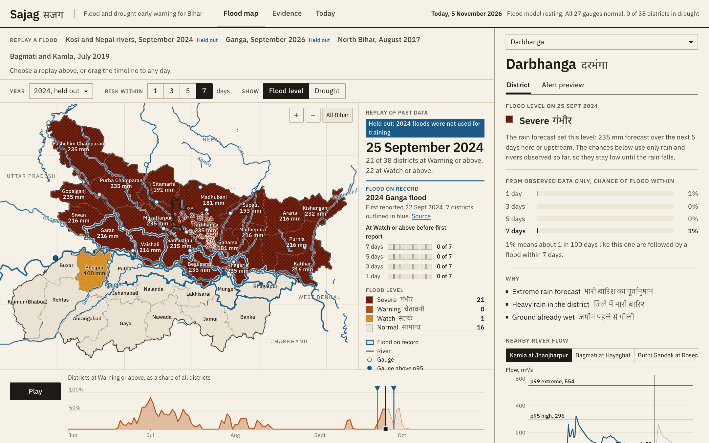
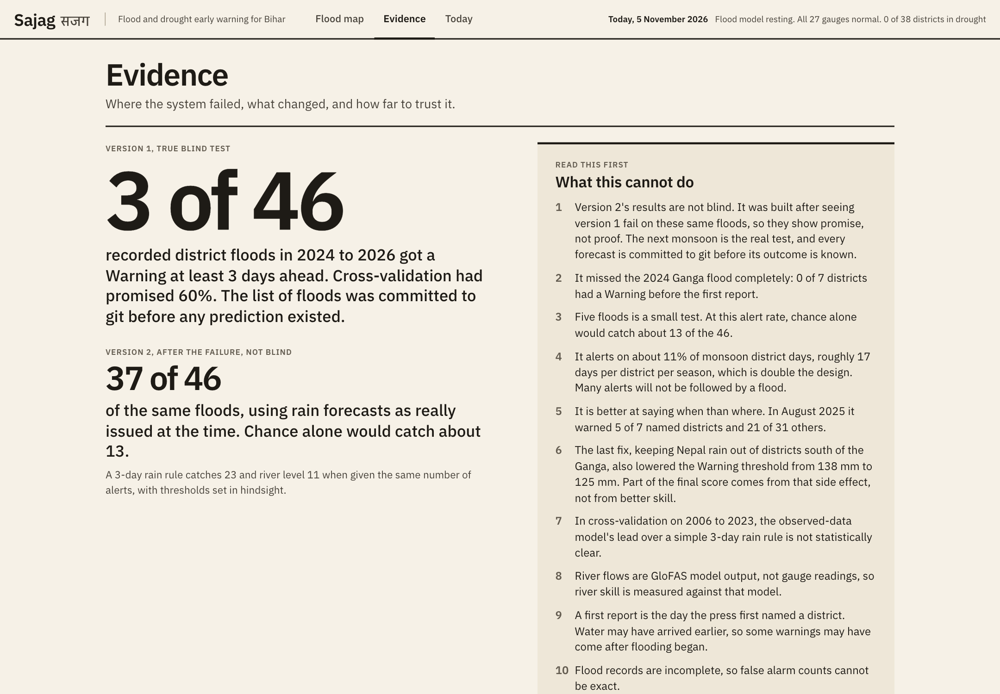
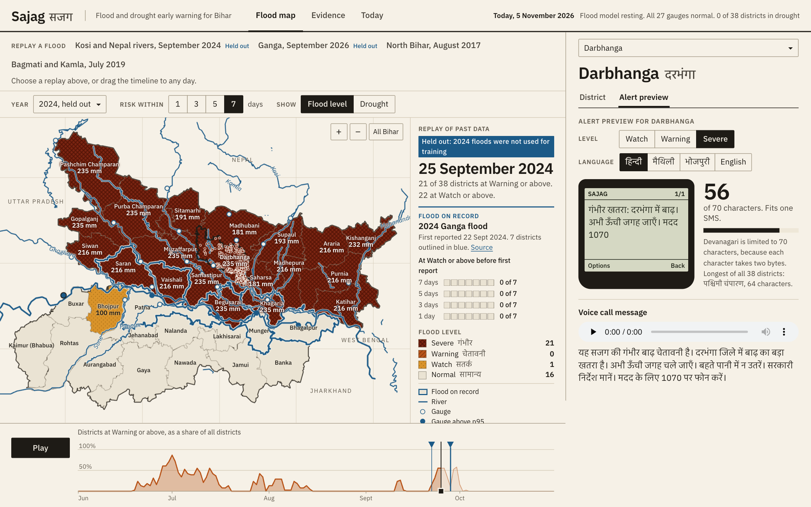
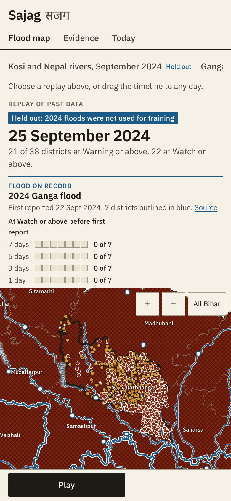

# Sajag (सजग): flood and drought early warning for Bihar

**Neural Storm 2026, Green Planet track, problem GP-03: Flood & Drought Early Warning System**

**Team:** Rounak Choudhary (solo), NIT Patna

**Live demo:** https://rounak251.github.io/sajag/



Sajag forecasts flood risk for Bihar's 38 districts, rates 37,007 villages and towns by exposure, tracks drought, and writes the warning as a one-part SMS and a voice message in Hindi, Maithili, Bhojpuri and English. A Python job on GitHub Actions refreshes the forecast every morning, so it runs with no server, no API keys and no hosting bill.

## The test that failed

Before running the first model on 2024 to 2026, I wrote down 46 district floods from 5 events, using press reports, and [committed the list](data/reference/blind_test_events.csv) to git. Cross-validation had said the model would catch 60% of floods at least 3 days ahead. On the blind test it caught **3 of 46**.

| Rule | Warned 3+ days ahead, of 46 |
|---|---|
| Version 1, cross-validation promised 60% | **3** |
| 3-day rain threshold | 10 |
| River level threshold | 6 |

It lost to both simple rules. Three things were wrong:

1. **It had learned the calendar.** Only 1 of its 25 training floods began after mid-September, so it treated late September as safe. On 28 September 2024 it gave Darbhanga 0.3% with 161 mm of rain in 3 days.
2. **It barely knew the Ganga.** My own data cleaning had dropped the 2016 Ganga flood.
3. **It could not see rain coming.** Rain fell in Nepal on 26 to 28 September 2024 and the flood was reported on the 28th. A model that only reads rain already fallen cannot warn on the 25th.

Cross-validation hid the first problem and even favoured the calendar feature, because the training years share the same gap.

## What changed, and how far to trust it

Version 2 removes the calendar input, restores the 2016 flood from a sourced district list, and adds a plain rule: raise the alert when extreme rain is forecast over a district or the basin above it. The forecasts are the ones really issued at the time, from the [Open-Meteo Previous Runs archive](https://open-meteo.com/en/docs/previous-runs-api), averaging ECMWF and GFS.

**These results are not blind.** Version 2 was built after seeing version 1 fail on the same floods.

| Flood | First report | Districts | Warned 3+ days ahead | Rain rule, same alerts | River rule, same alerts |
|---|---|---|---|---|---|
| 2024 Ganga flood | 22 Sep 2024 | 7 | **0** | 4 | 2 |
| 2024 Nepal rivers flood | 28 Sep 2024 | 14 | **14** | 6 | 0 |
| 2025 August Ganga flood | 3 Aug 2025 | 7 | **6** | 2 | 3 |
| 2026 September Ganga flood | 5 Sep 2026 | 12 | **11** | 5 | 4 |
| 2026 late September flood | 30 Sep 2026 | 6 | **6** | 6 | 2 |
| **Total** | | **46** | **37** | **23** | **11** |

The baselines get the same 11.1% alert rate as Sajag, with thresholds set in hindsight, so the comparison favours them.

The check I trust most is the September 2024 timeline: no alerts from 9 to 21 September, then all 14 named districts at Warning by the 24th, four days before the first report.

Three checks on whether the 37 is real:

- **Luck.** Moving each flood to random days of the same monsoon, 2,000 times, gives 13.5 on average and 27 at the 95th percentile.
- **Place.** An early version warned all 24 other districts in September 2024, because a lookup tied Banka and Nawada to the Kosi, which cannot reach them. After the fix, 7 of those 24 were warned. In August 2025 it is still weak: 5 of 7 named districts and 21 of 31 others.
- **A side effect.** That same fix lowered the Warning threshold from 138 mm to 125 mm, which lifted the score from 32 to 37. Part of that gain is not new skill.

The real test is the next monsoon. Each daily run writes [`forecast_log/`](forecast_log) and commits it, so every forecast is on record before its outcome is known.

## Results

**River forecast, the part that passed the blind test.** Scored on 2024 to 2026 and unchanged since the blind run. The score is average precision for a river crossing its 99th percentile while it is still below it. The target is GloFAS modelled flow, not gauge readings.

| Days ahead | Sajag | Persistence | NSE, Sajag | NSE, persistence |
|---|---|---|---|---|
| 1 | 0.677 | 0.217 | 0.988 | 0.981 |
| 3 | 0.531 | 0.267 | 0.957 | 0.924 |
| 5 | 0.420 | 0.275 | 0.921 | 0.854 |
| 7 | 0.372 | 0.287 | 0.882 | 0.777 |

**Cross-validation, 2006 to 2023, observed data only.** All methods alert on the same 5% of district days, and 3-year blocks are held out together. Sajag caught 51% of 133 flood starts at least 3 days ahead (95% interval 31% to 68%, resampling whole events), against 43% for 3-day rain, 32% for river level and 17% for climatology. The lead over the rain rule is not statistically clear: the interval on the difference runs from -9 to +24 points.

**Drought.** The share of districts with SPI-3 at or below -1 at the end of August separates the 6 years Bihar declared drought from the rest with AUC 0.94, and the forecast from the end of July reaches 0.88. Six years is few, and a declaration is partly a political decision. Month to month, the forecast only just beats assuming nothing changes (AUC 0.875 against 0.859).

**Village exposure.** The score uses a satellite water record ending in 2021 plus land height, so it knows nothing of 2024. Tested on a Sentinel-1 flood map of the Kosi plain from 9 October 2024, flood water was mapped within 500 m of 34.7% of high-exposure villages, 15.3% of medium and 3.7% of low, across 6,222 villages. That is one flood, on one date, in one area.

Every number is on the [Evidence page](https://rounak251.github.io/sajag/#evidence), with the ablations and reliability plot.

## How it works

1. **District flood risk.** LightGBM, 5 seeds averaged, trained on recorded floods from 2006 to 2023. Rain and river inputs are constrained so more water can never lower the risk. SHAP values become the plain-language reasons on screen.
2. **Rain-forecast rule.** Raises the level when the 5-day forecast passes the 90th, 95th or 98th percentile of rain that really fell in 2006 to 2023.
3. **River forecast.** LightGBM across 27 sites, predicting peak flow 1 to 7 days out from upstream gauges and rain at 17 headwater points, most of them in Nepal.
4. **Drought.** SPI on NASA POWER rainfall, with a one-month forecast.
5. **Alerts.** Templates tested so every SMS fits one message for all 38 district names: 70 characters in Devanagari, 160 in English. Audio is generated for IVR.

### Data problems worth knowing about

- IMD's records change format around 2005. Earlier rows cover all 38 districts for weeks, so training starts in 2006.
- Day and month are swapped in some rows: `07-11-2017` with a 3-day duration ending 13 July means 11 July. Durations and record order repaired 10 of 119 events ([`sajag/sources/ifi.py`](sajag/sources/ifi.py)).
- Of 59 monsoon events since 2006, only 25 describe river flooding. The rest are heavy-rain deaths.

### Limits

- Five floods is a small test, and the results above are not blind.
- It missed the 2024 Ganga flood entirely.
- It alerts on about 11% of monsoon district days, roughly 17 per district per season, double the design. Many alerts will not be followed by a flood.
- River flows are GloFAS model output. A first report is when the press named a district, so water may have arrived earlier.
- Flood records are incomplete, so false alarms cannot be counted exactly.
- The rain rule can only be tested from 2024, when the forecast archive starts.
- Village lists are thin for Sheohar (8) and Sitamarhi (73).
- Maithili and Bhojpuri text was drafted by an AI tool and needs review by native speakers. Their audio uses a Hindi voice.

**This is a research prototype, not an official warning.** Follow IMD, CWC and BSDMA instructions.

## Tech stack

Python 3.12, LightGBM, scikit-learn, SciPy, pandas, NumPy, GeoPandas, rasterio, Shapely, pytest and ruff. The dashboard is plain HTML, CSS and JavaScript with Leaflet and IBM Plex fonts, all vendored. GitHub Actions and GitHub Pages run the daily job and hosting.

| Data | Used for | Source |
|---|---|---|
| India Flood Inventory v3 | Flood labels | [IIT Delhi and IMD](https://github.com/hydrosenselab/India-Flood-Inventory) |
| NASA POWER | Rain and soil wetness | [NASA](https://power.larc.nasa.gov/) |
| GloFAS | River flow | [Copernicus, via Open-Meteo](https://open-meteo.com/en/docs/flood-api) |
| ECMWF IFS and GFS | Rain forecasts | [Open-Meteo](https://open-meteo.com/) |
| Global Surface Water | Village exposure | [JRC](https://global-surface-water.appspot.com/) |
| Copernicus GLO-90 | Land height | [ESA, on AWS](https://registry.opendata.aws/copernicus-dem/) |
| GeoNames, OpenStreetMap | Village names and rivers | [GeoNames](https://www.geonames.org/), [OSM](https://www.openstreetmap.org/) |
| geoBoundaries | District outlines | [geoBoundaries](https://www.geoboundaries.org/) |

## Setup

You need Python 3.12 and [uv](https://docs.astral.sh/uv/). No API keys.

```bash
git clone https://github.com/rounak251/sajag.git
cd sajag
make setup
```

## Run it locally

The repo includes the trained models and dashboard data, so this is all you need to see it working:

```bash
make serve          # http://localhost:8000
make test           # unit tests
.venv/bin/python -m sajag.forecast   # today's forecast from live data
```

To rebuild everything from raw data, which downloads about 250 MB and takes roughly an hour, mostly waiting on API rate limits:

```bash
make data train score web
```

`make score` includes `scripts/blind_test.py`, which now scores version 2. Version 1's blind result is kept in [`artifacts/metrics_blind.json`](artifacts/metrics_blind.json), and it can be traced in the commit history: the test list is in `c388381` and the result in `1a78945`.

`scripts/make_audio.py` records the voice messages and needs macOS. `scripts/build_villages.py` runs its flood map check only if the optional Sentinel-1 map is present.

## Screenshots

| Evidence | Alert preview | Phone |
|---|---|---|
|  |  |  |

## AI tools used

Built with [Claude Code](https://claude.com/claude-code) (Claude Opus). It wrote the code, the dashboard and this README, ran the experiments, and drafted the Maithili and Bhojpuri messages, with Rounak Choudhary directing the project.

## Built during the hackathon

All code in this repo was written on 4 and 5 November 2026, within the extended submission window. The Sentinel-1 flood map used to test village exposure comes from the author's earlier SARITA project. It is used only for that check, and no earlier code was reused.

## License

MIT. Data sources keep their own licences.
